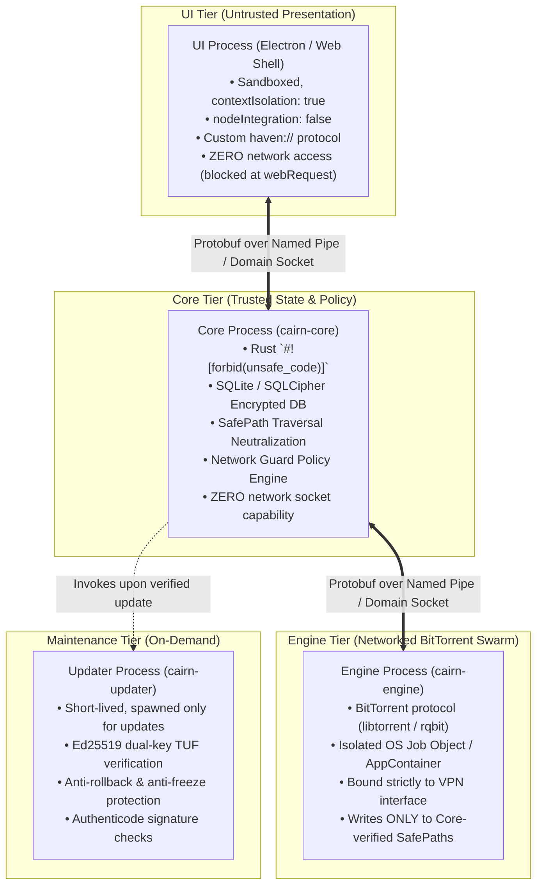

# 🏗️ Project Haven: System Architecture & Security Specification

> **Single Source of Architectural Truth for Developers and AI Coding Agents**  
> *Conforms to `docs/PLAN.md` (Parts I, II, III), `AGENTS.md`, and Security Invariants INV-01 through INV-14.*

---

## 1. Executive Summary & Design Philosophy

Haven (formerly Cairn) is a high-performance, ad-free, zero-telemetry BitTorrent client engineered under a **zero-trust, fail-closed security model**. It operates on the core axiom that **every peer and every torrent payload on the open internet is actively hostile**.

### Non-Negotiable Core Tenets:
1. **Zero Tracking & Radical Purity**: No ads, no analytics, no third-party telemetry SDKs, no behavioral tracking, and no cloud dependencies.
2. **Fail-Closed Security**: If a privacy guarantee cannot be enforced (e.g. VPN drops), all peer traffic halts immediately within 1 second. It never falls back to an unprotected connection.
3. **Defense-in-Depth Process Isolation**: The desktop client is segregated into four distinct operating system processes with strictly bounded privileges.
4. **Untrusted Content Quarantine**: The user interface never touches raw disk or raw network directly. All file paths pass through SafePath traversal neutralization. Downloaded files are quarantined and marked with OS security identifiers.

---

## 2. Multi-Process Isolation Architecture

Haven implements a 4-tier process isolation model on desktop operating systems (Windows, macOS, Linux):



### Process Capabilities & Restrictions Matrix:

| Process | Language / Runtime | Network Access | Disk Access | OS Keystore | IPC Endpoint |
|---|---|---|---|---|---|
| **UI (Renderer)** | HTML5 / CSS / Vanilla JS | **FORBIDDEN (0%)** | None (Mediated by Core) | No | Named Pipe / Unix Socket (`proto/`) |
| **Core** | Rust (`cairn-core`) | **FORBIDDEN (0%)** | State DB & metadata only | **Yes** (Master Key) | Named Pipe Server |
| **Engine** | Rust (`cairn-engine`) | **Swarm Only** (VPN Bound) | Pre-allocated SafePaths only | No | Named Pipe Client |
| **Updater** | Rust / C# (`cairn-updater`) | **HTTPS Only** (Pinned Host) | Temp staging directory only | No | CLI parameters & exit codes |

---

## 3. Inter-Process Communication (IPC) & API Protocol

- **Single Source of Truth**: All inter-process communication is defined in [`proto/cairn.proto`](../proto/cairn.proto) using Protocol Buffers v3.
- **Transport Layer**:
  - **Windows**: Windows Named Pipes (`\\.\pipe\haven-core-ui` and `\\.\pipe\haven-core-engine`) with restricted discretionary access control lists (DACLs) granting access only to the current user's security token.
  - **Linux / macOS**: Unix Domain Sockets in `$XDG_RUNTIME_DIR/haven.sock` with `0700` POSIX permissions.
  - **Binding Prohibition**: Haven **NEVER** binds a TCP listener to `0.0.0.0` or `127.0.0.1` by default. Remote control (v1.1) requires explicit user enablement, TLS, and token authorization per ADR-5.
- **Message Framing**: Length-prefixed framing (4-byte big-endian unsigned integer representing message byte size). Payloads exceeding 16 MiB are dropped immediately.

---

## 4. Storage & SafePath Protection (Section 16.4)

Torrent files contain untrusted, peer-supplied file paths that can attempt directory traversal attacks, device hijacking, or Unicode obfuscation. All storage operations pass through the **SafePath** algorithm in `cairn-safety`:

1. **Path Traversal Neutralization**:
   - Rejects any path component containing `..` or `.`.
   - Strips leading forward and backward slashes.
   - Forbids absolute path specifications (e.g. `C:\`, `/etc/`).
2. **Windows Reserved Device Name Sanitization**:
   - Rejects Windows legacy DOS devices: `CON`, `PRN`, `AUX`, `NUL`, `COM1` through `COM9`, `LPT1` through `LPT9`.
   - Rejects reserved names even when disguised with file extensions (e.g., `nul.txt`, `con.iso`).
3. **Bidirectional (BiDi) & Control Character Scrubbing**:
   - Rejects Unicode right-to-left override characters (e.g., `U+202E`) used in filename extension spoofing attacks.
   - Rejects NUL bytes (`\0`) and non-printable control characters.
4. **Deterministic Collision Resolution**:
   - Files with identical case-insensitive names on Windows/macOS are deterministically renamed using safe suffixes (e.g., `report (1).pdf`).
5. **Mark-of-the-Web (Zone.Identifier)**:
   - On Windows, all completed downloads receive an NTFS Alternate Data Stream (`Zone.Identifier`) marking the file as originating from the untrusted Internet zone.
6. **Risky File Warnings (`INV-05`)**:
   - Executables (`.exe`, `.msi`, `.bat`, `.cmd`, `.ps1`, `.scr`, `.vbs`, `.iso`) display prominent security warning indicators on the Add Sheet prior to user download confirmation.

---

## 5. Network Guard & Leak Prevention (INV-02, SR-06, SR-07)

The **Network Guard** guarantees zero IP leaks by strictly enforcing fail-closed network binding:

1. **Interface Binding**:
   - Engine sockets are bound directly to the specified VPN adapter interface (e.g., `wg0`, `tun0`, WireGuard/OpenVPN adapter GUID).
   - If no VPN interface is active while Private Mode is engaged, all network connections are refused.
2. **Active Physical Leak Detection**:
   - Core compares the public route against the known physical ISP IP range.
   - If packets attempt to traverse the physical default gateway, Network Guard trips within 1 second.
3. **Fail-Closed Killswitch**:
   - If the VPN adapter disconnects, transitions to inactive, or changes routes, Network Guard immediately signals `cairn-engine` to drop all active peer sockets.
   - No traffic is buffered or held in hope of reconnection; connections fail closed.

---

## 6. Cryptographic Update System (Section 39.2)

Haven avoids the vulnerabilities of unauthenticated or single-key updates by implementing an offline dual-key TUF-inspired update architecture:

- **Offline Ed25519 Signatures**:
  - Updates require valid Ed25519 digital signatures.
  - The signing CLI (`tools/haven_sign.js`) runs offline on an air-gapped machine. Private keys are never stored in git or CI.
- **Dual-Key Pinned Hierarchy**:
  - The client embeds two pinned public keys: a Primary Root Key and a Backup Recovery Key.
  - A compromised primary key can be rotated using the backup key.
- **Anti-Freeze Protection**:
  - Update manifests include an `expires_at` UTC timestamp (valid for a maximum of 14 days). Stale or expired manifests are rejected.
- **Anti-Rollback Protection**:
  - Manifests include a monotonically increasing integer version counter (`version_code`). Older or identical versions are rejected.
- **SHA-256 Payload Integrity**:
  - Every platform binary has an explicit SHA-256 checksum recorded in the signed manifest. The updater verifies the hash before replacing any files.
- **Automatic Crash Rollback**:
  - If a new update fails to launch cleanly on its first run, Haven automatically rolls back to the previous working installation.

---

## 7. Distribution, Packaging & Web Presence

Haven is distributed across three clean channels:

### A. Windows Desktop App (`desktop/`)
- Packaged using `@electron/packager` with full ASLR, DEP, and hardened runtime flags.
- Assets served via custom privileged protocol `haven://app/` (never `http://localhost`).
- Per-User Installer (`Haven-Setup.exe` / `Haven-Setup.bat`):
  - Installs to `%LOCALAPPDATA%\Programs\Haven`.
  - Creates Start Menu shortcut.
  - Registers HKCU uninstaller that preserves user downloads.
  - Requires **zero administrator privileges**.
- Standalone Portable Archive (`Haven-Portable.zip`):
  - Zero-install extraction to any folder or USB drive.

### B. Official Website (`site/`)
- Built with a high-precision dot-matrix engineering aesthetic, responsive layouts, and light/dark theme toggles.
- **Landing Page (`site/index.html`)**: Product hero, active transfer preview, feature architecture cards, daemon terminal card.
- **Download Guide (`site/download.html`)**: Recommended Build box, direct clean downloads (`Haven-Setup.exe`, `Haven-Portable.zip`), and 3-step setup guide (Option A Drag & Drop, Option B Command Prompt mode).
- **GitHub Pages CI (`.github/workflows/pages.yml`)**: Automated static deployment to `https://abeeshsengottuvel.github.io/Torrent/`.

### C. Live Web Experience (`site/experience.html`)
- An in-browser, fully interactive simulation of the Haven client.
- Visitors can test drive active transfers, inspector tabs (Overview, Files, Peers, Trackers, Pieces, Bandwidth), and simulated network drops without downloading anything.

---

## 8. Codebase Directory Map

```text
Haven/
├── AGENTS.md                          # Binding rules and security invariants for AI agents
├── README.md                          # Main repository guide and quick start
├── start-haven-pc.bat                 # One-click Windows desktop launcher
├── start-haven-pc.sh                  # One-click Linux / macOS launcher
│
├── .github/
│   └── workflows/
│       ├── pages.yml                  # GitHub Pages automated deployment
│       └── release.yml                # Hardened release pipeline (pinned commit SHAs)
│
├── docs/
│   ├── ARCHITECTURE.md                # This document: system architecture & security spec
│   ├── PLAN.md                        # Master Architecture & Delivery Plan (Parts I, II, III)
│   ├── AUDIT-1.md                     # Security audit matrix (INV-01..14, SR-01..25)
│   ├── D0-REPORT.md                   # Task D0 completion and proof report
│   ├── UPDATE-DESIGN.md               # Ed25519 signed update manifest specification
│   ├── NAME-CHECK.md                  # Trademark and package registry audit
│   ├── dependencies.md                # Dependency registry with license verification
│   └── adr/
│       └── 0001-engine.md             # Architecture Decision Record: Torrent engine
│
├── proto/
│   └── cairn.proto                    # Protobuf API definition (Single source of truth)
│
├── core/                              # Rust Backend Workspace
│   ├── Cargo.toml                     # Workspace configuration (#![forbid(unsafe_code)])
│   ├── cairn-core/                    # State machine, SQLite DB, broker, bencode parser, NetGuard
│   ├── cairn-engine/                  # BitTorrent engine abstraction, sandbox & event mapping
│   ├── cairn-safety/                  # SafePath algorithm & quarantine logic
│   └── cairn-fuzz/                    # Fuzz targets & regression seeds
│
├── desktop/                           # Electron Desktop Shell
│   ├── main.js                        # Hardened main process (haven:// protocol, no network)
│   ├── preload.js                     # Context-isolated IPC bridge
│   ├── package.json                   # Desktop build configuration
│   ├── web/                           # Packaged frontend assets
│   └── dist/                          # Packaged standalone desktop binaries & installers
│
├── site/                              # Official Website & Live Experience
│   ├── index.html                     # Landing page (Dot-matrix engineering aesthetic)
│   ├── download.html                  # Download & Easy Setup Guide
│   ├── experience.html                # Interactive browser client simulation
│   ├── style.css                      # Design system, CSS variables, dark/light themes
│   ├── site.js                        # Theme persistence & clipboard copy logic
│   ├── experience.css                 # Client styling for web experience
│   ├── experience.js                  # Client state machine simulation
│   └── downloads/                     # Production download binaries (Haven-Setup.exe, Haven-Portable.zip)
│
└── tools/                             # Automation & Hardening Tools
    ├── check_no_telemetry.py          # CI scanner for banned tracking & telemetry keywords
    ├── serve_site.py                  # Local production server with RFC 6266 headers
    ├── haven_sign.js                  # Offline Ed25519 signing CLI (keygen, sign, verify)
    ├── test_updater_tamper.js         # 9-point updater tamper & verification test suite
    ├── install.ps1                    # Automated installer test script
    └── installer_src/                 # C# source for per-user installer & uninstaller
```

---

## 9. Binding Rules for Future AI Coding Agents

When working on this repository, you **MUST** adhere to the following rules:

1. **Zero Telemetry**: Never introduce analytics, tracking SDKs, telemetry beacons, or external diagnostic phone-home calls. Always verify with `python tools/check_no_telemetry.py`.
2. **Strict Network Boundaries**:
   - The UI process (`desktop/`) must **NEVER** initiate network calls.
   - The Core process (`core/cairn-core`) must **NEVER** initiate network calls.
   - All network code belongs exclusively in `core/cairn-engine` and the updater.
3. **No Unsafe Code**:
   - `#![forbid(unsafe_code)]` is strictly enforced across `cairn-core` and `cairn-safety`.
   - No `unwrap()` or `expect()` outside unit test modules. Use checked arithmetic (`checked_add`, `checked_mul`) for untrusted numbers.
4. **Parser Hardening**:
   - Every input parser must enforce check-then-allocate limits (16 MiB max file, 64 max recursion depth).
5. **Safe Storage**:
   - Never accept a file path from the UI or peer swarm without running it through `SafePath::sanitize()`.
6. **Verification First**:
   - Run `node tools/test_updater_tamper.js` and `python tools/check_no_telemetry.py` before submitting any changes.
